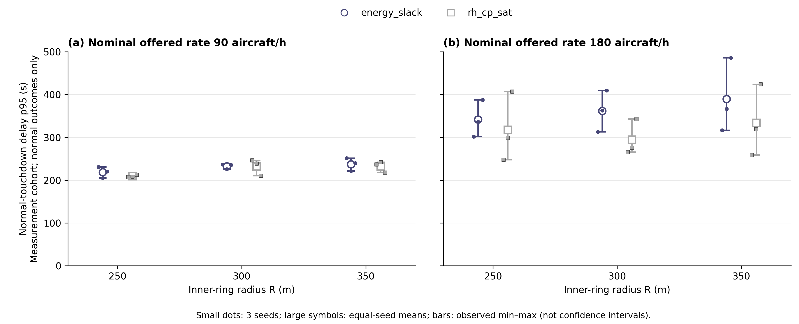

# 同版本几何研究：半径、延迟与联合服务质量

修复后的几何研究已完成 **36/36 jobs**：inner 半径 250/300/350 m × 标称 Poisson 到达率 90/180 aircraft/h × seeds 11/23/71 × 两方法 energy_slack（ES）与 rh_cp_sat（CP）。warmup/measurement/drain=600/1800/600 s，接地 SLA=600 s，reserve 要求为接地 SOC≥0.25。所有组合均为 6 pads、相同半服务时间分布。三个 source-v2 campaigns 均完成，已有[研究报告](../../artifacts/full_capacity_20261025/geometry_study_report/report.json)完整覆盖；本导出仅读取报告，不运行仿真或重新分析 jobs。

所有 jobs 使用 source `afa8b9fb780b2f63f1bfe1f08564798dc43f72e379137a7b0f5361d561271db9`，方法配对 18 个、相对 R=300 m 的 factor 配对 24 个，unavailable=0。旧 v1 的 24 个几何 jobs 全部排除，包括其中 4 个完成项；v1 [非几何研究](full_capacity_nongeometry_results.md)与本 v2 几何研究保持分开，不把跨版本 half6 拼接为同质对照。当前预定 screening 的两个子研究均已完成；进一步阈值验证仍待开展，不能据此宣告完整研究目标已完成。

## 从必要界到有限时域观测

几何同时改变静态储存量、稳定等待功率和最早接地时间。静态槽位关系为 \(K(R)=\lfloor\pi/\arcsin[d/(2R)]\rfloor\)；正常能量可行性要求 \(Q(s_i-0.25)\ge E_{move,i}+\sum_rP_rW_{ir}\)。final 阶段的必要时间下界至少为径向位移/速度、垂直位移/速度及消除初始水平速度所需时间三者的最大值。相应[理论笔记](terminal_service_capacity.md)与[必要界补充](full_capacity_bounds_derivation.md)解释这些约束的对象与单位。

| Inner R（m） | 设计 K | 稳定等待功率（W） | 接地时间必要下界（s） | 零损失 pad 上界（/h） | ε=0.05 offered 上界（/h） |
|---:|---:|---:|---:|---:|---:|
| 250 | 15 | 100521.5 | 73.0 | 271.6981 | 296.6014 |
| 300 | 18 | 92773.1 | 73.5 | 271.6981 | 296.6014 |
| 350 | 21 | 85651.9 | 75.5 | 271.6981 | 296.6014 |

所有半径的 pad 数和类别工作量分布相同，因此零损失与允许 5% 非正常质量的 pad 必要界均相同。它们约束长期 offered-rate 的必要资源工作量，不保证能量、分离、SLA 或具体策略可达；不能从更大的 K 或更低等待功率直接推出更低延迟或更高服务容量。

联合服务质量的分母为测量 cohort 的**全部外部 offered 请求**；分子要求正常接地、在 600 s SLA 内且接地 SOC≥0.25。drain 延长跟踪，不改变分母。下面 joint/offered 为三个 seed 的计数之和，联合均值对 seed 等权；二者口径不同，均保留。pass 列依次给出联合比例≥0.90、≥0.95、≥0.99 的 seed 数，每项分母均为 3；0.95 为主要阈值，0.90/0.99 为协议规定的次要阈值。**p95 仅针对该测量 cohort 中正常接地者**，不含应急与失败，因此不能替代全 offered 的联合服务质量。

| R（m） | 标称率 /h | 方法 | joint/offered | 联合均值 [min,max] | pass90,95,99（各 /3） | 正常延迟 p95 均值 [min,max]（s） | pad util 均值 | inner 等待均值（aircraft-s） |
|---:|---:|---|---:|---:|---:|---:|---:|---:|
| 250 | 90 | ES | 125/125 | 1.000000 [1.000000,1.000000] | 3,3,3 | 218.811 [205.248,231.054] | 0.3144 | 8.333 |
| 250 | 90 | CP | 125/125 | 1.000000 [1.000000,1.000000] | 3,3,3 | 209.227 [207.079,212.366] | 0.3157 | 52.990 |
| 250 | 180 | ES | 232/233 | 0.995935 [0.987805,1.000000] | 3,3,2 | 341.996 [301.957,387.607] | 0.6010 | 1764.237 |
| 250 | 180 | CP | 230/233 | 0.987805 [0.963415,1.000000] | 3,3,2 | 317.735 [247.513,406.836] | 0.5925 | 1878.637 |
| 300 | 90 | ES | 125/125 | 1.000000 [1.000000,1.000000] | 3,3,3 | 232.555 [225.436,236.850] | 0.3146 | 13.580 |
| 300 | 90 | CP | 125/125 | 1.000000 [1.000000,1.000000] | 3,3,3 | 231.664 [210.314,246.027] | 0.3152 | 77.916 |
| 300 | 180 | ES | 232/233 | 0.995935 [0.987805,1.000000] | 3,3,2 | 361.676 [312.739,409.544] | 0.6071 | 2126.588 |
| 300 | 180 | CP | 232/233 | 0.995935 [0.987805,1.000000] | 3,3,2 | 294.577 [265.513,342.677] | 0.5997 | 1490.987 |
| 350 | 90 | ES | 125/125 | 1.000000 [1.000000,1.000000] | 3,3,3 | 237.396 [221.238,251.170] | 0.3146 | 123.058 |
| 350 | 90 | CP | 125/125 | 1.000000 [1.000000,1.000000] | 3,3,3 | 231.958 [217.797,241.681] | 0.3131 | 52.036 |
| 350 | 180 | ES | 231/233 | 0.991870 [0.975610,1.000000] | 3,3,2 | 389.544 [316.404,485.821] | 0.5955 | 3857.829 |
| 350 | 180 | CP | 230/233 | 0.987805 [0.963415,1.000000] | 3,3,2 | 333.878 [258.957,423.700] | 0.6005 | 2923.169 |

全部 36 jobs 的联合比例均≥0.95；90/h 下全部为 1。180/h 下，R=300 m 的 ES/CP 均值为 0.995935/0.995935，R=250 m 为 0.995935/0.987805，R=350 m 为 0.991870/0.987805。当前两载荷点未定位任何半径的服务质量阈值，不能由这些接近 1 的比例作容量排名。

inner 等待量来自事件重建，统计到仿真结束的**全部已准入飞机，包括 warmup 到达**，单位为 aircraft-s；它与 p95 的测量 cohort 不是同一群体，不能把其总量差直接分解为 p95 的原因。

## 同 seed 延迟差分及其解释范围

以下取已有配对结果，在标称 180/h 下比较同 seed、同方法的 profile−R300 正常延迟 p95 差分；正数表示该 profile 的 p95 更高。各范围是三个配对 seed 的实际 min–max，不是置信区间。

| 半径相对 R300 | 方法 | p95 差分均值（s） | 配对 min–max（s） |
|---|---|---:|---:|
| radius250−half6 | ES | -19.680 | [-26.320,-10.782] |
| radius250−half6 | CP | +23.158 | [-18.000,+64.158] |
| radius350−half6 | ES | +27.868 | [+3.663,+76.277] |
| radius350−half6 | CP | +39.301 | [-6.556,+81.022] |

R350 相对 R300 的 p95 差分均值在 ES/CP 下分别为 +27.868/+39.301 s；ES 三个差分均为正，CP 包含负值。R250 的 ES 差分均为负，CP 的范围则跨越 0。这些观测未建立普遍半径排序，也未独立识别因果机制。增大半径同时扩大缓冲槽位、降低稳定等待功率，并改变运动路径、相位/冲突关系及固定搜索预算覆盖的候选集合；更大的缓冲与更低的功率不保证端到端延迟下降。CP 的有限候选求解结果也不构成物理全局最优或容量证书。

## 数量界与审计口径

有限 cohort LP 的整数数量上界在 0/36 jobs 小于 offered，即本次全部 36 项均为平凡 N；没有一项违例。该放松界并未在本 screening 中给出有效的紧容量区分。全部 jobs 的 offered 计数合计为 2148，正常及联合完成均为 2137，应急为 11，失败、rerouted、upstream pending 与 airborne pending 均为 0。这些数跨方法和配置重复计入相同随机输入，仅用于结果核算，不能解释为 2148 个独立样本。

配置、manifest、存储/重算 cohort、cohort/world 请求守恒检查均为 true；所有 selected results 的 terminated_invalid=false，审计遗漏飞机为 0。能量恒等式最大绝对残差为 4.634261131286621e-06 J，等待重建最大绝对残差为 1.818989403545856e-12 s。`derived_move_energy` 是总能耗减稳定等待能耗的残差，不是独立积分；这些数值检查不验证物理 surrogate 的真实性。有效仿真内的 emergency/failure 结局与实现无效的 INVALID 是不同概念。

本结果只有 3 seeds，均值与范围均为描述性观测；不作显著性、长期稳定性或精确服务容量阈值主张。进一步阈值验证及完整研究进度见[状态文档](full_capacity_validation_status.md)。

## 图与机器导出数据



图注：面板 (a)/(b) 分别为标称 90/180 aircraft/h。三个离散半径各显示两方法的错位标记；小标记为 3 个 seed，空心大标记为等权均值，竖线为观测 min–max（非 CI）。延迟只针对测量 cohort 的正常接地者；所有 36 jobs 的全 offered 联合比例另列于上表。半径点之间不连线，不作平滑或插值拟合。

Figure Contract：以完整 36-job report 为主要证据，采用两面板 quantitative grid / discrete point-range，分别显示两个载荷点的正常延迟分布。核心观察是增加 K、降低等待功率并未保证延迟下降；小样本及正常结局条件化是主要解释边界。CSV 源数据与图共同交付，图不承担容量阈值或独立因果机制证明。

QA Contract：12 行 summary / 36 行 per-seed / 42 行 paired 数据全部导出；n=3、正常结局筛选与 min–max 非 CI 均已标注。两方法沿用非几何图的圆/方标记与颜色，y 轴从 0 起；SVG 文字可编辑，PNG 为 300 dpi。自动 SVG QA 已通过（21 个可编辑文字元素、无禁用色板、灰度检查通过）；主对话已于北京时间 2026-10-27 完成当前图稿的视觉与数据复核。未指定 venue，不宣称特定投稿规范认证。

数据：[summary](tables/full_capacity_geometry_summary.csv)、[per-seed](tables/full_capacity_geometry_per_seed.csv)、[paired](tables/full_capacity_geometry_paired.csv)；图：[SVG](figures/full_capacity_geometry_delay.svg)、[PNG](figures/full_capacity_geometry_delay.png)。paired CSV 仅选取已有的 18 个同 seed 方法差分（CP−ES）和 24 个同 source 的 profile−half6 差分，不构造新配对。

重建命令（只读已有报告）：

```powershell
.\venv\Scripts\python.exe scripts/analysis/export_full_capacity_geometry_results.py
```
