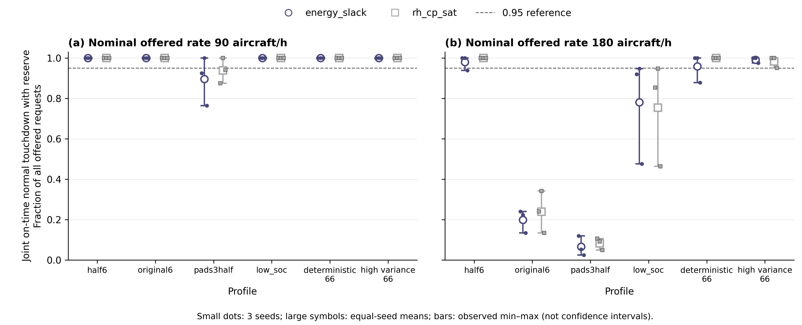

# 非几何因素：完整终端服务质量结果

本研究的非几何子集已完成 **72/72 jobs**：6 profiles × 2 标称 Poisson 到达率（90/180 aircraft/h）× 3 seeds（11/23/71）× 2 methods。inner 半径固定为 300 m、设计槽位数 K=18；除 pads3half 使用 3 pads 外均为 6 pads。warmup/measurement/drain 为 600/1800/600 s，接地 SLA 为 600 s，reserve 要求为接地 SOC≥0.25。联合服务质量以测量 cohort 的**全部外部 offered 请求**为分母，正常接地、满足 SLA 与 reserve 三条件同时成立才计入分子；drain 继续跟踪该 cohort，不改变分母。

结果读取自已有 [report.json](../../artifacts/full_capacity_20261025/nongeometry_study_report/report.json)，未运行新仿真或重分析原 jobs。原 96-job campaign 的 24 个旧几何 jobs 全部排除（含 4 个旧完成项），保留原始状态；其 20 个 INVALID 使父 campaign 的 `run.exit=1`，与非几何子集完整性并不矛盾。子集沿用 source `d119f7744405a568f6862274d0b31608f524aae8536f8a9c2f8b7e75f816f606`；36 个同 seed 方法配对和 60 个 profile 对 half6 配对均已存在于报告，unavailable=0。本文完成非几何结果交付；截至本次导出，修复后的同版本几何研究仍为 **35/36，1 job pending**，完整研究尚未完成，见[状态文档](full_capacity_validation_status.md)。

## 观测服务质量与必要资源界

pad 工作量守恒给出零损失必要上界 \(3600m/E[13.5+S]\)。允许非正常比例 ε 时，\(C^{UB}_{offered}(ε)=3600m/\min_{0≤q≤p,\sum q≥1-ε}\sum_cq_c(13.5+S_c)\)，乐观允许优先舍弃较长服务类别。推导见[必要界补充](full_capacity_bounds_derivation.md)。这些是长期 offered-rate 的必要上界，不保证 SLA、SOC、空域分离或某策略可达，也不能与有限 cohort 接地吞吐混作同一对象。

| Profile | 零损失 pad 上界（/h） | ε=0.05 offered 上界（/h） |
|---|---:|---:|
| half6 | 271.6981 | 296.6014 |
| original6 | 148.4536 | 162.6200 |
| pads3half | 135.8491 | 148.3007 |
| low_soc | 271.6981 | 296.6014 |
| deterministic66 | 271.6981 | 285.9980 |
| high_variance66 | 271.6981 | 296.6014 |

下表由 [24 行 summary CSV](tables/full_capacity_nongeometry_summary.csv) 自动生成；方法缩写 ES=energy_slack、CP=rh_cp_sat。联合均值对 3 个 seed 等权，范围为实际最小–最大值；joint/offered 是三个 seed 的计数之和，**其比值不替代等权 seed 均值**。pass 是联合比例≥0.95 的 seed 数。p95 列是各 seed 正常接地延迟 p95 的均值，pad util 是测量窗口物理 pad 占用比例的 seed 均值。

| Profile | 标称率 /h | 方法 | joint/offered | 联合均值 [min,max] | pass /3 | 正常延迟 p95 均值 s | pad util 均值 |
|---|---:|---|---:|---:|---:|---:|---:|
| half6 | 90 | ES | 125/125 | 1.0000 [1.0000,1.0000] | 3/3 | 232.555 | 0.3146 |
| half6 | 90 | CP | 125/125 | 1.0000 [1.0000,1.0000] | 3/3 | 231.776 | 0.3152 |
| half6 | 180 | ES | 228/233 | 0.9797 [0.9390,1.0000] | 2/3 | 383.774 | 0.5984 |
| half6 | 180 | CP | 233/233 | 1.0000 [1.0000,1.0000] | 3/3 | 310.856 | 0.6033 |
| original6 | 90 | ES | 125/125 | 1.0000 [1.0000,1.0000] | 3/3 | 362.554 | 0.5723 |
| original6 | 90 | CP | 125/125 | 1.0000 [1.0000,1.0000] | 3/3 | 323.500 | 0.5764 |
| original6 | 180 | ES | 46/233 | 0.1993 [0.1341,0.2400] | 0/3 | 563.889 | 0.7209 |
| original6 | 180 | CP | 55/233 | 0.2388 [0.1341,0.3421] | 0/3 | 529.813 | 0.7076 |
| pads3half | 90 | ES | 110/125 | 0.8966 [0.7647,1.0000] | 1/3 | 490.160 | 0.5847 |
| pads3half | 90 | CP | 117/125 | 0.9387 [0.8750,1.0000] | 1/3 | 457.213 | 0.5958 |
| pads3half | 180 | ES | 15/233 | 0.0657 [0.0244,0.1200] | 0/3 | 476.500 | 0.5947 |
| pads3half | 180 | CP | 19/233 | 0.0825 [0.0488,0.1067] | 0/3 | 522.095 | 0.5752 |
| low_soc | 90 | ES | 125/125 | 1.0000 [1.0000,1.0000] | 3/3 | 247.757 | 0.3178 |
| low_soc | 90 | CP | 125/125 | 1.0000 [1.0000,1.0000] | 3/3 | 239.401 | 0.3161 |
| low_soc | 180 | ES | 180/233 | 0.7810 [0.4756,0.9474] | 0/3 | 387.888 | 0.5769 |
| low_soc | 180 | CP | 174/233 | 0.7547 [0.4634,0.9474] | 0/3 | 363.981 | 0.5817 |
| deterministic66 | 90 | ES | 125/125 | 1.0000 [1.0000,1.0000] | 3/3 | 252.327 | 0.3125 |
| deterministic66 | 90 | CP | 125/125 | 1.0000 [1.0000,1.0000] | 3/3 | 229.440 | 0.3110 |
| deterministic66 | 180 | ES | 223/233 | 0.9593 [0.8780,1.0000] | 2/3 | 353.722 | 0.5811 |
| deterministic66 | 180 | CP | 233/233 | 1.0000 [1.0000,1.0000] | 3/3 | 319.901 | 0.5956 |
| high_variance66 | 90 | ES | 125/125 | 1.0000 [1.0000,1.0000] | 3/3 | 242.534 | 0.3210 |
| high_variance66 | 90 | CP | 125/125 | 1.0000 [1.0000,1.0000] | 3/3 | 221.485 | 0.3218 |
| high_variance66 | 180 | ES | 231/233 | 0.9919 [0.9756,1.0000] | 3/3 | 364.598 | 0.6210 |
| high_variance66 | 180 | CP | 229/233 | 0.9837 [0.9512,1.0000] | 3/3 | 348.667 | 0.6172 |

### 相同均值服务时间不决定有限时域表现

half6、deterministic66 与 high_variance66 均为 6 pad、E[S]=66 s，其零损失 pad 上界相同（271.6981/h），但在标称 180/h 下 ES 联合均值依次为 0.9797、0.9593、0.9919，CP 为 1.0000、1.0000、0.9837。这些样本不支持“服务方差越大，表现必然越差”的单调规律；CP 在 half6 与 deterministic66 上较高，在 high_variance66 上较低，也未显示对所有配置一致占优。相同均值只保证该零损失工作量界相同；ε=0.05 的选择性界还依赖类别分布，deterministic66 的值为 285.9980/h。

### 能量与 pad 数共同限制实现服务质量

low_soc 的 pad 资源界与 half6 不变，但标称 180/h 的 ES/CP 联合均值降为 0.7810/0.7547，两方法均为 0/3 seeds 达到 0.95；正常/应急/失败计数分别为 ES 180/49/4、CP 174/54/5。这显示被测策略对初始 SOC 的敏感性，说明仅用 pad 工作量界不能解释完整服务质量。当前必要 pad 界不含 SOC，并非计算错误。上游等待不消耗 SOC；能量约束从正式准入后作用，不能把外部释放后的全部等待直接解释为 SOC 消耗。不同准入决策仍可能减少空中等待，因此该结果不证明最优物理容量随低 SOC 下降。

pads3half 的零损失与 ε=0.05 offered 上界为 135.8491/h 和 148.3007/h。在 90/h（低于这两个资源上界）时 ES/CP 均值已为 0.8966/0.9387，两方法均仅 1/3 seeds 达到 0.95；180/h 时为 0.0657/0.0825。必要工作量条件不是充分条件；测量窗口 pad busy utilization 小于 1，也不能证明仍有可被当前受限到达、能量和冲突过程利用的闲余容量。

original6 的服务时间较长，零损失上界为 148.4536/h，ε=0.05 为 162.6200/h。90/h 下两方法所有 seeds 联合比例均为 1；180/h 下 ES/CP 联合均值为 0.1993/0.2388。界与实际结果之间的差距同时包含有限时域、能量、运动学、分离和策略等因素，不能解释为纯调度损失或策略最优性差距。

### 有限 cohort 界与核算边界

有限 cohort LP 数量上界仅在 2/72 jobs 小于 offered，其余 70 项均为平凡 N。两个非平凡项均为 pads3half、seed 71、180/h：

| 方法 | offered | 有限 cohort 整数上界 | 观测联合完成 |
|---|---:|---:|---:|
| energy_slack | 82 | 81 | 2 |
| rh_cp_sat | 82 | 81 | 4 |

该界仅将 82 个 offered 请求的乐观正常按时完成上界收紧至 81；观测联合完成分别为 2 和 4，并未与上界接近。LP 放松了 SOC 等约束，故不能据此单独归因于调度器。

全部 72 jobs 共有 4296 个 offered 计数和 3343 个联合完成计数；六类结局合计为正常 3348、应急 555、失败 346、rerouted 0、upstream pending 0、airborne pending 47。这里跨配置与方法重复计入相同随机输入，仅用于逐 job 核算，不能解释为 4296 个独立样本。`failure` 是有效仿真内的运行结局，与实现无效的 `INVALID` 不同。

配置、manifest、存储 cohort 与重算 cohort、cohort/world 请求守恒检查均为 true；所有 selected results 的 terminated_invalid=false，机制审计遗漏飞机为 0。能量恒等式最大绝对残差为 0.0004319995641708374 J，等待重建最大绝对残差为 4.547473508864641e-12 s。`derived_move_energy` 是总能耗减去稳定等待能耗得到的残差，不是独立积分；数值核算一致性不验证能耗或轨迹物理 surrogate 的真实性。

只有 3 seeds，均值与 min–max 是描述性统计而非置信区间，本文未作显著性检验。90/180 两个标称率不足以定位 half6 的服务质量阈值，也不足以证明长期稳定容量；不插值拟合阈值。

## 图与可复用数据



图注：两个面板分别显示标称 90 与 180 aircraft/h。每个类别包含两方法的横向错位标记，细点为 seeds 11/23/71，较大空心标记为等权 seed 均值，竖线为观测 min–max（非置信区间）。分母为全部 offered 请求；虚线是 0.95 参考线，类别之间不连线。

Figure Contract：核心证据是相同资源必要界下的有限时域服务质量仍随 profile 和方法变化；证据来自完整 72-job report 的逐 seed 结果。采用两面板 quantitative grid / categorical point-range，分别回答 90/h 与 180/h 的配置差异；主要风险为小样本范围被误作置信区间或容量阈值，故逐 seed 全部显示、不作插值。未指定投稿 venue，当前为通用论文全宽版式。

QA Contract：CSV 覆盖 24 summary / 72 per-seed / 96 paired 行；全量数据、完整 offered 分母、n=3、min–max 非 CI 已明示。两方法同时用颜色和圆/方标记区分；y 轴为 0–1.03；SVG 保留可编辑文字，PNG 为 300 dpi。自动 SVG QA 已通过（32 个可编辑文字元素、无禁用色板、灰度检查通过）；主对话已于北京时间 2026-10-27 完成当前图稿的视觉与数据复核。未指定目标 venue，以上不构成特定投稿规范的最终认证。

导出文件：[summary](tables/full_capacity_nongeometry_summary.csv)、[per-seed](tables/full_capacity_nongeometry_per_seed.csv)、[paired](tables/full_capacity_nongeometry_paired.csv)、[SVG](figures/full_capacity_nongeometry_qos.svg)、[PNG](figures/full_capacity_nongeometry_qos.png)。paired CSV 直接选取报告已有的同 seed 方法差分（CP−ES，36 行）及 profile−half6 差分（60 行），不构造跨版本或新增配对。

重建命令（读取现有报告，不运行仿真）：

```powershell
.\venv\Scripts\python.exe scripts/analysis/export_full_capacity_nongeometry_results.py
```
