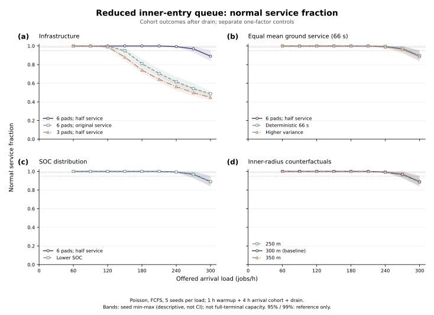

# 多环终端区的储存、能量与服务容量：研究工作笔记

日期：2026-10-25。对象为当前 `rotating_slots` 旋转槽位模型，非历史 `fixed_terminal` 模型。当前理论对象是模型已实现的进场/正常着陆服务，未模拟起飞与充电，不能直接称为起降混合总容量；扩展时需加入到离场共享资源冲突。本文整理可由物理量、资源占用和守恒关系计算的理论框架，区分必要上界、条件充分证书与数值机制近似；尚未证明全终端容量，也未完成创新性检索。除特别注明外，时间为 s、能量为 J、功率为 W，公式内流率为 aircraft/s，报告容量乘 3600 后为 aircraft/h。

## 1. 先明确“容量”是什么

| 对象 | 量纲与含义 | 不能替代的对象 |
|---|---|---|
| 几何储存量 \(K_{\rm geom}\) | aircraft，独立稳定圆环的静态排列上限 | 动态安全与每小时服务量 |
| 运行可用槽位 \(K_{\rm free}(z)\) | aircraft，扣除实际占用、未来预约及冲突后的状态量 | 静态未占用格数 |
| 固定类别混合工作量上界 \(C_{\rm work}^{UB}\) | aircraft/h，必需资源时间给出的正常流上限 | 可达到的服务保证 |
| 服务质量约束容量 \(C_{\rm srv}^{\pi}\) | aircraft/h，给定需求规律和因果策略的可接受外部流率 | 短窗口完成率 |
| 观测吞吐 \(\widehat x_N(H)\) | aircraft/h，窗口内正常接地数除以时长 | 长期稳定容量 |
| 剩余接收域 \(\mathcal R(z,H)\) | 按类别划分的请求向量集合 | 一个固定标量 |

因此，83 个槽位不能直接与 150 aircraft/h 比大小。储存限制约束某时刻的在场数量，服务限制约束随时间完成的工作。

## 2. 圆环几何只回答静态储存问题

半径 \(R_r>0\)、最小两机距离 \(d>0\) 的独立稳定圆环，若 \(d\le2R_r\)，相邻夹角至少为 \(2\arcsin[d/(2R_r)]\)，故

\[
K_r=\left\lfloor\frac{\pi}{\arcsin[d/(2R_r)]}\right\rfloor.
\]

若 \(d>2R_r\)，仍可容纳单机，故取 \(K_r=1\)。各环的 \(K_r\) 仅在跨环距离也满足要求时相加。当前 \(R=(600,450,300)\) m、设计间隔 100 m，得到 \(37+28+18=83\)；相邻环径差 150 m 足以满足这一静态跨环条件。若仅代入硬分离距离 80 m，则得 \(47+35+23=105\)。105 是假设性几何数值，既非获准槽位数，也非转移、最后进近和预约组合的动态安全证明。

当前固定角速度 \(\omega=0.035\) rad/s，因而

\[
v_r=\omega R_r,\qquad a_r=\omega^2R_r.
\]

改变半径同时改变速度、向心加速度与功率。后续应另设固定线速度对照，避免把几何收益与能耗变化混为一项。圆周截面的几何通过频率 \(q_r=K_r\omega/(2\pi)\) 也不是离环率：当前模型允许任意相位发起满足约束的转移，并非每机只能经过固定出口一次才可离开。

inner 半径也通过运动时间进入服务约束。记 pad 布局半径为 \(R_p\)，捕获高度 \(h_{\rm cap}=15\) m，水平/垂直速度上限分别为 \(v_{h,\max}=25\) m/s、\(v_{z,\max}=2\) m/s，水平加速度上限为 \(a_{h,\max}=1.5\) m/s²。以初始水平速度 \(\omega R\)、捕获时水平速度为零、起始高度 \(h\) 考虑，final 机动段（到捕获点）时长的必要运动学下界为

\[
t_f\ge\max\left\{\frac{(R-R_p)_+}{v_{h,\max}},\frac{(h-h_{\rm cap})_+}{v_{z,\max}},\frac{\omega R}{a_{h,\max}}\right\},
\qquad t_{\rm final+descent}\ge t_f+13.5.
\]

三项分别来自至少跨越的径向距离、下降到捕获高度的距离和消除初始速度所需时间。这些是必要下界，非可实现时间；实际相位、C2 连续性、jerk、路径分离以及当前至少 20 s 的模板时间网格均可施加更强限制。增大 inner 半径同时改变储存量、稳定等待功率、机动时长与冲突几何，因此简化队列中的半径趋势不推出完整终端容量的单调性。

## 3. 必需资源时间给出正常流的必要上界

设正常完成的类别 \(c\) 流率为 \(x_c\)，资源 \(j\) 同时可服务 \(m_j\) 架，每架该类正常完成所需的平均资源时间为 \(a_{jc}\)（s/aircraft，包含重复访问）。在平稳或长时间极限、窗口边界遗留工作除以时长趋零时，资源占用守恒给出

\[
\sum_c x_ca_{jc}\le m_j. \tag{1}
\]

证明是将窗口内所有该资源的占用时间相加：总量不超过 \(m_jH\)，与完成机群归属工作量之差只有跨窗口边界的工作；除以 \(H\) 后取极限。固定且全部服务的类别比例 \(p_c\) 满足 \(\sum_cp_c=1\)，则

\[
C_{\rm work}^{UB}=3600\min_j\frac{m_j}{\sum_cp_ca_{jc}}. \tag{2}
\]

这只是必要条件。有限储存造成的阻塞、相位、跨环冲突和安全轨迹耦合仍会降低可达流率。以物理必需时间下界代入 \(a_{jc}\)，得到乐观上界；以某策略的实测驻留均值代入，则是该运行条件下的占用关系，不能升级为通用容量证明。pad 与停车资源可分别成为瓶颈的思想见 [Guerreiro 等，2020](https://ntrs.nasa.gov/citations/20205001421)，但其到离场平衡系统与本项目到场模型不同。

当前正常 pad 保护区间为 \([t_{\rm td}-13.5,t_{\rm td}+S_c)\)。实现见 [world.py](../../terminal_marl/core/rotating_slots/world.py)，源码行 1022–1064；13.5 s 是垂直下降保护段，水平 final 在当前实现另需 20–300 s（5 s 网格，见 [trajectory.py](../../terminal_marl/core/rotating_slots/trajectory.py)，源码行 478–490），不能从全流程删除。若六个 pad 可独立并行，基线 \(E[S]=132\) s，half service 为 66 s，则

\[
C_{\rm pad}^{UB}=\frac{6\times3600}{13.5+E[S]}
=\begin{cases}148.453608\ldots,&\text{baseline},\\271.698113\ldots,&\text{half}.\end{cases}
\]

half 的该项上界为 baseline 的 1.83019 倍，并非翻倍。仅计地面时间的 163.636364 / 327.272727 aircraft/h 更宽松；正确平均是 \(m/E[S]\)，不是 \(mE[1/S]\)。任务时长方差可在均值不变时改变等待与尾部风险，但不能对任意多服务器服务分布宣称普适随机序定理。

pad 独立性也有几何条件：半径 100 m 圆周放置 \(m\) 个 pad，相邻弦长为 \(200\sin(\pi/m)\)。六个时为 100 m；按 80 m 静态分离最多七个，八个已经违反。因此在不改布局的情况下增加 pad 数并继续按独立服务器计算不成立；更细的进近和地面方向约束仍须检查，参见 [Saxena 等](https://arxiv.org/abs/2408.01152)。

## 4. SOC 将等待量限制为能量可行域

对请求 \(i\)，给定合法机动轨迹 \(\gamma\) 与各环稳定等待时间 \(W_{ir}\ge0\)，电池容量和 reserve 为

\[
Q=252\times85\times3600\ \mathrm J,\qquad s_{\rm res}=0.25.
\]

在当前稳定功率模型下，正常完成的能量约束为

\[
\sum_rP_rW_{ir}+E_{{\rm move},i}(\gamma)
\le Q(s_i-0.25). \tag{3}
\]

这是选定有效轨迹与稳定等待的能量核算，不含拟合系数；比较等待分配时须固定相同的机动段，或重新核算其变化。峰值功率预算、安全间隔、资源日历和轨迹有效性是另外的约束。单环等待预算

\[
W_{ir}^{\max}(\gamma)=\frac{Q(s_i-0.25)-E_{{\rm move},i}(\gamma)}{P_r}
\]

仅针对该路线、且其他等待为零；分子为负说明该路线不能正常完成。代码的 `normal_energy_lower_bound` 低估必需后续能量，据此得到的等待预算偏乐观，不能作为可行性证书。

既有档案中的 outer/middle/inner 稳定功率依次为 68078.0091368、74812.8697204、92773.1284706 W。若时序与路线仍可行、其他能量相同，把 \(\delta\) s 等待由 inner 移到 outer，可节省 \((P_{\rm inner}-P_{\rm outer})\delta\) J；这不推出所有需求下“尽量外环等待”最优，因为转移窗口、下游供给和阻塞可能改变。SOC 与任务类型应使用联合分布；合成基线以外不默认独立。

上述功率来自当前基于文献的研究替代模型，尚非经真实航空器电池功率实测标定的数值。当前物理仿真按逻辑时钟推进，调度计算延迟并未注入运动执行时间；未来解释实际运行服务容量时，还须计入真实计算、通信与执行时序造成的等待和可执行窗口变化。

### 期限窗口的必要工作量检验

能量还可直接生成有限机群的服务期限。先考虑固定运动参数的松弛模型：对时刻 \(t\) 已处于 inner 的飞机，水平 final 时长为 \(f_i\)，含下降的全部机动能量为 \(E_i\)，稳定等待功率为 \(P_i\)，并暂把这些参数视为不随启动时刻变化。最晚 final 启动时间为

\[
\ell_i=t+\frac{Q(s_i-0.25)-E_i}{P_i}.
\]

若 \(\ell_i<t\)，该路线不能通过必要能量检验。其 pad 最早保护开始、最晚释放及必需占用分别为

\[
r_i=t+f_i,\qquad d_i=\ell_i+f_i+13.5+S_i,\qquad p_i=13.5+S_i.
\]

对任意区间 \([u,v]\)，若每个候选本身满足 \(p_i\le d_i-r_i\)，则必须落入该区间的 pad 工作至少为

\[
w_i(u,v)=\big[p_i-(u-r_i)_+-(d_i-v)_+\big]_+.
\]

选择正常完成的飞机以 \(y_i\in\{0,1\}\) 表示，必要条件是

\[
\sum_i y_iw_i(u,v)\le m(v-u),\qquad \forall u<v. \tag{3a}
\]

推导只需观察：在 \([u,v]\) 之前，飞机至多可使用 \((u-r_i)_+\) 秒；之后至多使用 \((d_i-v)_+\) 秒；余下工作必须挤入窗口。它即使允许抢占及迁移 pad 也仍然必要，因此不保证不可抢占、多资源、连续轨迹排程可行。该检验把低 SOC 集中到来的期限拥堵显式连接到资源容量：全局平均利用率低于 1，也可能违反某个短窗口的必要工作量约束。

上述 \(\ell_i,r_i,d_i\) 代数关系仅用于固定运动参数松弛，或已证明相应参数在整个启动窗口内有效的模板族；实际旋转模型的相位会改变 final 几何、能量与时长，不能把一条有效轨迹任意平移。完整模型应从有效路线/相位包络生成释放和截止窗口，并保留路线选择。只要 \(r_i,d_i,p_i\) 有效，式 (3a) 的必要性就独立成立；有限候选未找到解不能推出所有路线都不可行。

## 5. 可接受需求率需要服务质量与稳定性定义

固定几何及物理系统 \(G\)、到达过程族 \(A_\lambda\) 的突发规律、任务/SOC 联合分布 \(F\)，并固定只能使用当前及历史信息的因果策略 \(\pi\)。令 \(p_N^\pi\) 为外部请求最终正常接地的长期比例，分母包括拒绝、转送和未服务请求；初始在场机群单独统计。正常输出流为 \(x_N=\lambda p_N^\pi\)。令

\[
Y_i=\mathbf1\{\text{正常接地， }t_{{\rm td},i}-t_{{\rm release},i}\le d_{\max},
\ s_i(t_{{\rm td},i})\ge0.25\},\quad q_{\rm success}^\pi=E[Y_i].
\]

可操作定义为

\[
C_{\rm srv}^{\pi}(\epsilon,d_{\max},\eta;G,F)
=3600\sup\left\{\lambda:
\begin{array}{l}
p_N^\pi\ge1-\epsilon,\quad q_{\rm success}^\pi\ge1-\eta,\\
\text{上游队列稳定、无持续积累，且满足硬安全约束}
\end{array}\right\}. \tag{4}
\]

这里稳定可取平稳队列存在且平均积压有限，不能误解为随机到达下每条样本路径都存在统一有限峰值。概率对应同一外部到达机群的长期比例；release 应取外部需求释放时刻，不能从成功入场以后才计时，否则上游等待会被遗漏。拒绝与转送在该场定义中计为未正常服务，多场网络层则可另统计最终服务成功。若 \(\eta\le\epsilon\)，成功事件已隐含正常比例要求；也可改用“给定正常接地的超时概率”来分别约束两者。另报 energy-fail 与 emergency 比例，并可加入 \(p_{\rm fail}\le\epsilon_E\)。正常接地与地面任务完成是不同的统计出口，式 (2) 的 pad 工作仍包括接地后的服务。

最优容量 \(C^*=\sup_{\pi\in\Pi_{\rm causal,admissible}}C_{\rm srv}^{\pi}\) 与已测策略容量应分开；有限窗口预知未来的优化解只可作为相同实例的乐观参照。95% 或 99% 可作阈值示例，尚不是用户确定的验收要求。[Onat，2024](https://escholarship.org/uc/item/35f6b56g) 的摘要支持随机队列与高概率延迟容量这一研究方向，本文不据摘要引入其具体公式。

若允许选择性拒绝长任务，不能直接断言 offered capacity 不超过零损失固定混合的式 (2)。应保留类别接收域：

\[
0\le x_c\le\lambda_c,\quad
\sum_cx_c\ge(1-\epsilon)\sum_c\lambda_c,\quad Ax\le m. \tag{5}
\]

必要时再加 \(x_c\ge(1-\epsilon_c)\lambda_c\)，防止通过优先丢弃长任务或低 SOC 类别获得表面容量收益。阻塞与实际队列容量的区别亦见 [Onat、Lupien、Sengupta，2026](https://arxiv.org/abs/2609.37288)；本文不采用未经独立推导的方差到时间分布换算。

## 6. 从流量守恒到条件充分证书

每环满足 \(n_r(t+\Delta t)=n_r(t)+f_r^{\rm in}-f_r^{\rm out}\)。转移同时受上游已就绪供给、下游可用槽位和真实冲突可行集约束，不能添加未测量的“放行系数”。这一储存、守恒与 sending/receiving 思路来自 [Daganzo，1994](https://its.berkeley.edu/node/4777)，本项目仍须以真实连续轨迹定义可行集。

[Little 定律](https://pubsonline.informs.org/doi/10.1287/opre.9.3.383) 给出 \(E[N]=\lambda_{\rm eff}E[T]\)，但 \(T\) 随需求及策略变化，所以 \(K/E[T]\) 不是无条件容量公式，更不能把均值等式套到整个分布。

若独立构造并证明安全排程的服务保证 \(\beta(t)=R(t-T_0)^+\)，同时到达受 \(\alpha(t)=\sigma+\lambda t\) 包络，则在 \(\lambda\le R\) 下，网络演算给出

\[
B_{\max}\le\sigma+\lambda T_0,\qquad
D_{\max}\le T_0+\sigma/R. \tag{6}
\]

来源为 [Le Boudec / Thiran](https://leboudec.github.io/netcal/) 及[作者教程](https://leboudec.github.io/netcal/resources/tutorial-nc-grenoble-2019-EPFL.LEB.pdf)。这里的积压及 \(K\) 必须匹配所选累计输入 \(A\) 到累计输出 \(D\) 的同一系统边界，并说明是否计入正在服务的飞机，不能自动代入几何槽位总数 83。若 \(T_0>0\)、\(\sigma\le K\)，有限储存要求产生条件区域

\[
\lambda\le\min\{R,(K-\sigma)/T_0\}. \tag{7}
\]

再有已验证的机动能量上界、最大稳定功率 \(P_{\max}\)，可保守要求

\[
E_{\rm move}^{UB}+P_{\max}D_{\max}
\le Q(q_\epsilon-0.25),\qquad q_\epsilon=F_{\rm SOC}^{-1}(\epsilon). \tag{8}
\]

在与分位数尾部约定一致、连续 SOC 分布下，这覆盖至少 \(1-\epsilon\) 的 SOC；有原子时需显式按下尾概率选阈值。分类任务应采用类内 SOC 分位数及相应能量上界。式 (8) 以总等待不超过 \(D_{\max}\) 换取保守充分性；它还依赖所有请求确实处于所证明服务系统内。式 (7)–(8) 是无拟合的可计算证书，但前提是安全排程导出的 \(\beta\) 已获证明，且包含相位、冲突与离散单机服务的包化效应。式 (2) 的资源上界绝不能充当服务保证中的 \(R\)！当前完整终端的 \(\beta\) 尚未证明。Poisson 流没有有限的全时间确定突发包络，应采用受控整形或有限时域概率包络，并将包络失效概率计入可靠性。

## 7. 多起降场需要发布剩余接收域

起降场 \(v\) 在状态 \(z_v\)、规划窗口 \(H\) 内发布剩余资源日历、\(K_{\rm free}\) 和按类别的能量可行接收域。令 \(x_{vc}\) 为该窗口分配请求数，\(d_c\) 为需分配数，则路由至少满足

\[
\sum_vx_{vc}=d_c,\qquad A_vx_v\le b_v(H),\qquad
x_v\in\mathcal R_v(z_v,H). \tag{9}
\]

这里 \(A_v\) 的元素为资源秒/请求，\(b_v(H)\) 是扣除现有占用与预约后的资源秒。有限窗口的必要矩阵应计入确实必须在窗口内执行的工作；若要求完整 pad 服务也落在该窗口，才可用全服务时间，允许接地后服务越界时需截取相应工作或延长资源日历。使用类别平均时间作有限窗口近似时，应另标其统计性质。转场飞行更新到达 SOC、时间及接收场任务混合。静态必要工作量多面体只是外近似，真实接收仍须通过联合轨迹与预约检查。严格的有限窗口最大接收数可定义为：在固定现有占用、逐机能量及所有安全约束下，最大化在窗口内正常完成的新增请求数。本文只定义这一优化问题，尚未求解。

## 8. 既有证据与新机制实验的地位

下表全为 **preexisting_artifact**，直接读取 [v8_medium_baseline_facts.json](../../artifacts/rotating_slots_stage2_20261023/v8_medium_baseline_facts.json)、[v8_medium_final_summary.json](../../artifacts/rotating_slots_stage2_20261023/v8_medium_final_summary.json)，协议与限制见 [v8 状态文档](../rotating_slots_stage2/downstream_service_v8_status.md)。medium、seed 71、600 s、half service、六 pad；初始 airborne 24 架、新释放 33 架，offered 合计 57，需求过程标称 150 aircraft/h。

| 方法与档案 | normal / emergency / energy fail / pending | inner holding（aircraft-s） |
|---|---|---:|
| energy_slack v7 | 27 / 2 / 0 / 28 | 6803.744375 |
| energy_slack v8 | 30 / 1 / 0 / 26 | 4362.604979 |
| rh_cp_sat v7 | 22 / 4 / 0 / 31 | 7337.262313 |
| rh_cp_sat v8 | 28 / 3 / 0 / 26 | 4772.667912 |

相同几何下改变正常调度得到不同结局，支持运行结果依赖策略；整体修改的单 seed 对照不能隔离每项机制的因果贡献。尤其不能把 \(30/600\times3600\) 称为该到达过程的稳态容量：初始库存、随机释放与期末删失均在起作用。终态仍有 26 架待处理，较初始库存多 2 架，不能据此证明长期稳定。到终端外等待、转送或拒绝的能耗与风险必须另计，不能靠排除上游能耗制造收益。原始 service 的 3600 s 运行与 half service 的 360 s 运行时域不同，不是服务时间作用的配对因果证据。

### 新增 inner–pad FCFS 机制实验（newly_run）

新增实验为直接进入 inner 的 Poisson 到达队列，FCFS 分配最早可用 pad；任务与 SOC 标记在此合成实验中独立。它未包含水平 final、跨环转移、分离、rescue、峰值功率与完整终端耦合，并采用乐观 `normal_energy_lower_bound`。基准 \(K=18\) 仅统计下降前等待队列，既不是含服务机群的积压，也不是全终端 83 个几何槽位。半径变体未获完整引擎几何有效性验证。FCFS 限制可能降低性能，放松物理可能提高性能，方向相反，因此该近似对完整终端最优服务量不构成数学上界或下界，仅用于解释机制。

实现见 [数学及队列模块](../../terminal_marl/analysis/service_capacity.py)、[运行入口](../../scripts/analysis/run_service_capacity.py) 与 [定向测试](../../tests/test_service_capacity.py)。新增模块的定向测试为 10 项通过，本地小样本为 8/8；本节未把它们计作完整终端验证。正式结果源于提交 `992b8a6f488aee5242179ccd3533faa19a37b9a9`，原始 [results.json](../../../training_outputs/terminal/service_capacity_20261025/formal/results.json)、[summary.csv](../../../training_outputs/terminal/service_capacity_20261025/formal/summary.csv) 和 [run.exit](../../../training_outputs/terminal/service_capacity_20261025/formal/run.exit) 位于同步输出目录。2026-10-25 北京时间 13:34:14–13:34:24 运行，GNU real 9.52 s；2 worker、CPU 4/6、每进程数值库线程数 1。8 场景 × 9 到达率 × 5 seed 共 360/360 完成，exit 0，无 failed/missing/duplicate，360/360 满足请求守恒。

正式协议从空队列起步，warmup 3600 s 后统计 14400 s 的到达 cohort，最后执行完整服务日历 drain。seed 为 11、23、47、71、101，率网格为 60、90、120、150、180、210、240、270、300 aircraft/h。所有任务 drain 后等待与在服务数量均为 0，但 cohort 截止时的两类积压另存于原结果。`empirical_normal_rate_per_h` 是该到达机群正常结局数除以 cohort 时长的等效正常服务率；分子包含 cohort 结束后完成的服务，不能称为同一钟表窗口的实际离场吞吐。拒绝是抽象 nonnormal 结局，并未模拟物理 energy fail 或 emergency。

在已同步源码的服务器项目目录内，本轮实际执行命令如下；复现实验应固定对应源码版本并使用新的输出目录，保留本次原始结果：

```bash
OMP_NUM_THREADS=1 OPENBLAS_NUM_THREADS=1 MKL_NUM_THREADS=1 NUMEXPR_NUM_THREADS=1 \
taskset -c 4,6 /home/user/envs/terminal_env/bin/python scripts/analysis/run_service_capacity.py \
  --output /home/user/training_outputs/terminal/service_capacity_20261025/formal \
  --workers 2 --source-commit 992b8a6f488aee5242179ccd3533faa19a37b9a9
```

下表正常比例为每 seed 比例的**非加权算术均值**，每格 5 个 seed；不以所有请求合并后的比例替代。最后一列仅列出已测粗网格上均值达到 99% 的最高点，不是容量估计，也不是置信结论。

| 场景 | 分析 pad 上界（aircraft/h） | 240/h 正常比例均值 | 270/h 正常比例均值 | 已测均值 ≥99% 的最高网格点（aircraft/h） |
|---|---:|---:|---:|---:|
| baseline6half：6 pad、half service | 271.6981 | 99.3217% | 96.9132% | 240 |
| original6：6 pad、原服务时长 | 148.4536 | 61.6208% | 54.2425% | 120 |
| pads3half：3 pad、half service | 135.8491 | 56.3231% | 49.8292% | 90 |
| same_mean_deterministic：恒定 66 s | 271.6981 | 99.6667% | 97.4049% | 240 |
| same_mean_high_variance：等均值高方差 | 271.6981 | 98.8425% | 96.3557% | 210 |
| low_soc6half：较低 SOC | 271.6981 | 99.3684% | 96.6930% | 240 |
| inner_radius250：半径 250 m | 271.6981 | 99.1033% | 96.4010% | 240 |
| inner_radius350：半径 350 m | 271.6981 | 99.5210% | 97.3115% | 240 |



图：四面板分别比较基础设施、任务波动、SOC 与 inner 半径；曲线为 5 seed 非加权均值，阴影为观测 seed 最小值—最大值，**不是置信区间**。[绘图聚合数据](figures/service_capacity_plot_data.csv) 保留对应统计量。图和表仅描述简化队列，不给出完整终端容量界；本轮未计算置信区间，“正常比例达到 95%”与“95% 置信水平”是不同概念。

等均值三场景的服务均值均为 66 s，分析 pad 上界同为 271.6981 aircraft/h。baseline 的 30/60/120 s 比例为 0.2/0.6/0.2；高方差场景的 30/120 s 比例为 0.6/0.4。240/h 时，恒定与高方差正常均值相差 0.8242 个百分点，说明本次样本中相同均值上界不能决定有限缓冲队列的正常结局；未据此声称统计显著。baseline 在 270/h 的均值为 96.9132%，但 seed 范围达 92.9902%–99.8990%，故不能说全部 seed 都达到 95%。30/h 的粗网格也不能精确定位阈值，不作插值容量结论。原服务场景在 150/h 时均值为 94.8720%，对应分析上界 148.4536/h；nonnormal 仍须按抽象拒绝解释。

SOC 基准采用截断正态位置参数 0.75、标准差参数 0.08、区间 [0.60,0.90]，较低 SOC 场景改为 0.60、0.08、[0.45,0.75]。240/h 下两者五 seed 均有 4834 个请求：baseline 为 4801 normal、33 buffer reject、0 deadline reject；low SOC 为 4803 normal、14 buffer reject、17 deadline reject。正常比例均值从 99.3217% 微增到 99.3684%，不能解释为电量降低提高容量：本模型先检缓冲再检乐观等待期限，拒绝机群与后续队列随之改变。本轮只显示该简化队列中的 SOC 效应有限，未验证完整 SOC 服务容量。

250/300/350 m 的反事实半径分别使用 \(K=15/18/21\)、稳定功率 100.5215/92.7731/85.6519 kW，240/h 正常均值为 99.1033%/99.3217%/99.5210%。这同时混合缓冲与功率变化，且省略随半径变化的 final 时间和分离冲突，不能确定完整终端的最优半径。较大资源上界也不证明完整终端可达到相应服务量；后续仍需第 9 节的完整模拟验证。

## 9. 最小完整仿真验证与文献定位

下一步保留现有基线，独立扫到达率，设置一致的观察时域、warmup 与停止到达后的 drain；每点先用 3–5 个 seed，同一输入配对不同策略。在转变附近自适应补 2–3 个率点，报告成功率、延迟、积压漂移及其抽样不确定性，未决时域结局单列。先分别改变 SOC、任务服务、pad 和几何，再只补针对性的 inner 等待交互，避免全因子矩阵。策略表现可能非单调，不能预设单调性或直接以二分搜索代替验证。本节是后续计划，不表示已启动正式实验。

| 来源 | 本文对应主张与读取边界 |
|---|---|
| Guerreiro、Hagen、Maddalon、Butler，2020，Capacity and Throughput of UAM Vertiports，NASA | pad/停车资源及吞吐瓶颈；其 FCFS 模型含到离场平衡，不直接移植数值 |
| Saxena 等，arXiv:2408.01152v3 | 分离与地面方向约束影响吞吐 |
| Onat，2024，博士论文 | 仅核验摘要：随机双节点队列与高概率延迟容量；全文获取受 429 限制，未引用具体方程 |
| Onat、Lupien、Sengupta，2026，Vertiport Design Methodology and Capacity Analysis，arXiv:2609.37288 | 阻塞、队列与实用容量；不据其建立方差到延迟分布等式 |
| Daganzo，1994，DOI:10.1016/0191-2615(94)90002-7 | 有限储存、守恒、sending/receiving 框架 |
| Little，1961，DOI:10.1287/opre.9.3.383 | 稳态均值占用—流率—时间关系 |
| Le Boudec / Thiran，Network Calculus | 到达包络与服务曲线下的积压、延迟条件界 |

可进一步研究的贡献是把能量加权等待域、有限多环冲突/资源网络、QoS 接收容量域及解释性实验连接起来。上述组成各有已有文献；是否形成新的组合方法或定理，仍需更广的文献对照、可构造服务保证和完整仿真证据，本文不宣称“首次”或文献空白。

## 10. 完整模型验证的后续入口

完整仿真的必要资源界与适用边界见 [full_capacity_bounds_derivation.md](full_capacity_bounds_derivation.md)，单请求资格检查、配对 pilot 和首轮因素筛查的固定输入及统计口径见 [full_capacity_validation_protocol.md](full_capacity_validation_protocol.md)。本轮完整仿真结果仍待运行与复核；第 8 节的简化队列结果保持其原有解释范围，不作为完整终端容量或动态安全的验证结果。
